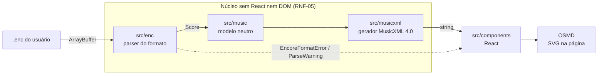

# ShirNote


_Shir_ (שיר) é “canção” em hebraico. Marca e ícone em [`docs/brand/`](docs/brand/).

Visualizador de partituras do Encore (`.enc`) que começou como app web e, em 04/11/2026, passou a
ser um **aplicativo Android mobile-first** de biblioteca, leitura e edição simples de partituras. O
arquivo é lido como `ArrayBuffer`, convertido para um modelo musical neutro, exportado como MusicXML e
renderizado com [OpenSheetMusicDisplay](https://opensheetmusicdisplay.org/) (OSMD).

O app móvel guarda a biblioteca em SQLite, abre `.enc`, MusicXML e PDF, transpõe por semitons, exporta
PDF/MusicXML e sincroniza com OneDrive e Google Drive. O site atual continua no ar como demonstração
do núcleo web; o produto é o aplicativo.

O formato `.enc` não tem especificação pública, então o projeto começou por engenharia reversa a
partir de amostras reais. Hoje o núcleo abre um `.enc` de verdade: lê o arquivo como `ArrayBuffer`,
converte com o parser de produto, exporta MusicXML e renderiza no OSMD — tudo local, sem upload. Um
script descartável (`scripts/enc-spike.mjs`) segue conferindo o parser com o MusicXML do Encore.

O produto e o planejamento estão em [`docs/`](docs/README.md), que explica qual documento vale para
quê:

- [`docs/PRD — App Móvel de Partituras ShirNote.md`](docs/PRD%20—%20App%20Móvel%20de%20Partituras%20ShirNote.md) — o produto atual
- [`docs/TECHSPEC — App Móvel ShirNote.md`](docs/TECHSPEC%20—%20App%20Móvel%20ShirNote.md) — como o app é construído e o que já existe
- [`archive/PRD — Visualizador Web de Partituras Encore (.enc).md`](<archive/PRD%20—%20Visualizador%20Web%20de%20Partituras%20Encore%20(.enc).md>) — o MVP web concluído (arquivado)
- [`archive/CRONOGRAMA — Visualizador Web de Partituras Encore (.enc).md`](<archive/CRONOGRAMA%20—%20Visualizador%20Web%20de%20Partituras%20Encore%20(.enc).md>) — cronograma do MVP web (arquivado)
- [`docs/enc-format.md`](docs/enc-format.md) — o que já foi provado sobre o formato
- [`docs/decisions/`](docs/decisions/README.md) — decisões arquiteturais (ADRs)

## Estado atual

O **MVP web** está concluído e continua no ar como demonstração. A Fase 1 fechou o portão G1 em
02/11/2026 ([ADR 0002](docs/decisions/0002-aprovar-portao-g1-e-iniciar-fase-2.md)), a Fase 2 (parser
de produto) fechou o G2 no mesmo dia e a Fase 4 (robustez) fechou o G4 em 04/11/2026, com o Safari
pendente por falta de macOS ([ADR 0004](docs/decisions/0004-adotar-regua-provisoria-de-desempenho-e-compatibilidade.md)).

Em **04/11/2026 o produto pivotou** para o aplicativo Android mobile-first
([PRD do app móvel](docs/PRD%20—%20App%20Móvel%20de%20Partituras%20ShirNote.md)). O PRD web fica como
registro do MVP; as fases 6 a 11 do novo PRD passam a valer. O núcleo e o site continuam sendo a base.

| Item                                                                             | Estado                                                                      |
| -------------------------------------------------------------------------------- | --------------------------------------------------------------------------- |
| Scaffold Vite + React + TypeScript + Vitest + ESLint/Prettier + CI               | pronto                                                                      |
| Modelo musical neutro (`src/music`) com testes                                   | pronto                                                                      |
| Gerador MusicXML `score-partwise` 4.0 (`src/musicxml`) com testes                | pronto, validado contra o XSD oficial                                       |
| Arquivo `.enc` renderizado no OSMD (`src/components`)                            | pronto — zoom, rolagem e erro verificados no G3; sem Web Worker             |
| Contrato do parser + diagnóstico hexadecimal de amostras (`src/enc`)             | pronto                                                                      |
| Leitor da cadeia de blocos do contêiner `.enc` (`src/enc`)                       | pronto, usado pelo parser de produto                                        |
| Spike do parser conferido com as referências (`scripts/enc-spike.mjs`)           | pronto                                                                      |
| Formato documentado (`docs/enc-format.md` v1.0)                                  | pronto para até duas partes e duas pautas, com lacunas declaradas           |
| Parser de produto (Fase 2)                                                       | pronto — confere nas 38 amostras; MusicXML abre no OSMD e no Verovio        |
| Robustez, desempenho, navegadores e acessibilidade (Fase 4)                      | pronto — G4 fechado; 56 compassos em 0,5 s com CPU a 4×; Safari pendente    |
| Exemplos para demonstração (RF-12)                                               | pronto — uma melodia real e duas amostras controladas no painel de abertura |
| Transposição por grau (`src/music/transpose.ts`, `docs/feature/transposicao.md`) | pronto — 17 casos de validação; no site, tom de destino e meio tom          |
| Impressão em páginas no site (papel, orientação, escala, margens)                | pronto — imprime ou salva PDF pelo navegador; nenhum compasso cortado       |
| App Android (Expo + React Native + WebView)                                      | em andamento — Fases 6 e 7 do PRD móvel                                     |
| Biblioteca SQLite + MusicXML (ADR 0006)                                          | implementada — testada no tablet em 06/11/2026 (G6)                         |
| Leitura com zoom, tela cheia, posição salva e metadados (Fase 7)                 | implementada — testada no tablet em 06/11/2026 (G7); zoom sem refluxo       |
| Transposição no app (RFM-06)                                                     | implementada — parte do modelo original; limite de ±12 semitons             |
| Exportação PDF/MusicXML e impressão                                              | planejado — Fase 8                                                          |
| OneDrive e Google Drive (ADR 0008)                                               | planejado — Fase 9                                                          |
| Compra validada no backend (ADR 0007)                                            | planejado — Fase 10                                                         |

O que se sabe sobre o formato, com base em 14 partituras reais (1.024 compassos), 24 amostras controladas
e MusicXML exportado pelo Encore para todas:

- **Comprovado, sem divergência contra o MusicXML:** cadeia de blocos, título, autor, 536 notas
  (altura, figura, ponto, acorde, ligadura, voz 1 e 2, tercina), pausas, armaduras com sustenido e
  bemol, troca de armadura e de fórmula, claves de sol, fá, dó na 3ª e 4ª linha e sol oitavada,
  troca de clave, segunda pauta, segunda parte, barras de repetição, barra final e barra dupla.
- **Hipótese ou sem amostra:** vozes 3 a 8, quiálteras além de 3:2, mais de duas partes e versão do
  formato.

## Comandos

```bash
npm install
npm run dev           # servidor de desenvolvimento
npm run build         # typecheck + build de produção
npm run test          # Vitest
npm run test:watch
npm run lint
docker compose up --build -d   # site em http://localhost:8088 (build de produção + nginx)
npm run format        # Prettier
npm run format:check
npm run typecheck
```

Node 22.12+ (testado com Node 24).

Ferramentas de engenharia reversa, sem dependências:

```bash
node scripts/enc-spike.mjs tests/fixtures/samples/justica-flauta2.enc \
  --check tests/fixtures/reference/justica-flauta2.xml
node scripts/enc-dump.mjs tests/fixtures/samples/justica-flauta2.enc --chunks
node scripts/enc-dump.mjs tests/fixtures/samples/justica-flauta2.enc --notes
node scripts/enc-diff.mjs tests/fixtures/controlled/controle-02-c4-seminima.enc \
  tests/fixtures/controlled/controle-04-c4-minima.enc --tag MEAS

# MusicXML do parser de produto, para abrir no MuseScore ou no Verovio (portão G2)
node scripts/export-musicxml.mjs tests/fixtures/samples/justica-flauta2.enc --out "$env:TEMP\justica.musicxml"
```

## Estrutura

```
src/
  enc/            contrato do parser, leitor de blocos, erros tipados e inspeção hexadecimal
  music/          modelo musical neutro: tipos, matemática de durações, validação
  musicxml/       gerador MusicXML e serializador XML
  components/     App, FileUploader, StatusBar, ScoreViewer (React + OSMD)
  test-utils/     builders de partituras usados só nos testes
scripts/          ferramentas de engenharia reversa (enc-dump, enc-diff, enc-spike, export-musicxml)
tests/fixtures/
  samples/        partituras reais
  controlled/     amostras geradas no Encore, um campo por arquivo
  reference/      MusicXML exportado pelo Encore para as partituras reais
  originals/      arquivos originais (nomes com acento) das cópias em samples/ e controlled/
docs/             PRD, TECHSPEC, enc-format.md, features (feature/) e ADRs (decisions/)
archive/          documentos finalizados (PRD e cronograma do MVP web), só histórico
```

## Arquitetura

Tudo roda no navegador; o arquivo nunca sai da máquina (RNF-01).



Cada camada conhece só a vizinha: `src/enc` e `src/musicxml` dependem de `src/music`, nunca um do
outro, e só `src/components` junta as camadas e usa o OSMD. No app móvel, o núcleo é reaproveitado sem
cópia pelo Metro e a partitura é desenhada numa WebView ([ADR 0005](docs/decisions/0005-adotar-expo-e-webview-com-osmd-no-app-movel.md)).
Onde cada parte do formato é lida está na seção 12 de [`docs/enc-format.md`](docs/enc-format.md).

## Decisões

As decisões estruturais ficam registradas como ADRs em [`docs/decisions/`](docs/decisions/README.md).
As demais escolhas de implementação:

- **React + Vite** em vez de TypeScript puro ou outro framework, porque o app mobile previsto será
  React Native e o time reaproveita o modelo de estado, os tipos e o conhecimento — ver
  [ADR 0001](docs/decisions/0001-adotar-react-e-react-native.md).
- **Modelo neutro próprio** em vez de gerar MusicXML direto do parser: permite aceitar outros
  formatos de entrada e trocar a saída sem tocar na leitura do `.enc`.
- **Zoom por `transform: scale()`** no contêiner do OSMD, não por `osmd.Zoom`: com `autoResize`, o
  OSMD reengravita a partitura na largura disponível e o zoom deixaria de ampliar de verdade.
- **`divisions` calculado pelo MMC exato** das durações presentes na partitura, em vez de um valor
  fixo: figuras de 64 avos e pontuadas continuam exatas.
- **Expo + React Native + WebView com OSMD** no app móvel: a interface é nativa e só a partitura usa
  DOM, reaproveitando o renderizador — ver
  [ADR 0005](docs/decisions/0005-adotar-expo-e-webview-com-osmd-no-app-movel.md).
- **SQLite + MusicXML canônico** na biblioteca: PDF fica como arquivo e o `.enc` original não é
  guardado — ver [ADR 0006](docs/decisions/0006-adotar-sqlite-e-musicxml-como-formato-da-biblioteca.md).
- **Compra validada no backend**, com direito assinado e RTDN — ver
  [ADR 0007](docs/decisions/0007-validar-compra-no-backend-e-conceder-direito.md).
- **Sincronização direta com OneDrive e Google Drive**, sem servidor de arquivos — ver
  [ADR 0008](docs/decisions/0008-sincronizar-biblioteca-com-onedrive-e-google-drive.md).

## Amostras `.enc`

As amostras da Fase 1 ficam em [`tests/fixtures/`](tests/fixtures/README.md), com o catálogo de
versão do Encore, sistema operacional e recurso comprovado por arquivo. Os direitos de uso das
partituras reais ainda estão a confirmar.

## Limitações conhecidas

- O bundle inclui o OSMD e passa de 500 kB (aviso do Vite); avaliar code splitting quando a UI
  estabilizar.
- Sem cursor/playback: o OSMD é usado só para desenhar a partitura.
- Ainda não exibidos: dinâmicas e textos; a interface avisa
  quando o arquivo os contém. Troca de clave no meio do compasso aparece no início dele.
- O formato só está comprovado para até duas partes e duas pautas, com até duas vozes por pauta. O
  restante está na seção 8 de `docs/enc-format.md`.
- Só o Encore `0xC4` é suportado; outras versões geram erro (ADR 0002).

Do app móvel (v1 em desenvolvimento):

- MusicXML importado é somente leitura: transpor exige um leitor de MusicXML para o modelo neutro,
  que ainda não existe.
- A sincronização é manual e não roda em segundo plano.
- PDF protegido por senha ou DRM não abre; o app recusa com aviso.
- O app Android ainda não foi publicado; as fases 6 a 11 do PRD móvel estão em andamento.
