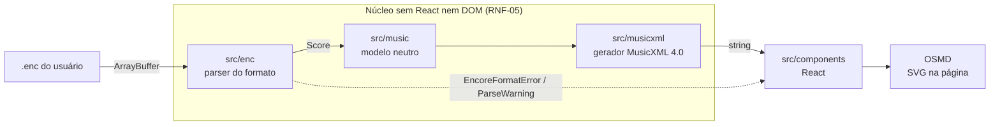

# ShirNote


_Shir_ (שיר) é “canção” em hebraico. Marca e ícone em [`docs/brand/`](docs/brand/).

Visualizador web de partituras do Encore (`.enc`) que roda inteiramente no navegador: o arquivo é
lido como `ArrayBuffer`, convertido para um modelo musical neutro, exportado como MusicXML e
renderizado com [OpenSheetMusicDisplay](https://opensheetmusicdisplay.org/) (OSMD).

O formato `.enc` não tem especificação pública, então o projeto começou por engenharia reversa a
partir de amostras reais. Hoje o app abre um `.enc` de verdade: lê o arquivo como `ArrayBuffer`,
converte com o parser de produto, exporta MusicXML e renderiza no OSMD — tudo local, sem upload. Um
script descartável (`scripts/enc-spike.mjs`) segue conferindo o parser com o MusicXML do Encore.

O produto e o planejamento estão em [`docs/`](docs/):

- [`docs/PRD — Visualizador Web de Partituras Encore (.enc).md`](<docs/PRD%20—%20Visualizador%20Web%20de%20Partituras%20Encore%20(.enc).md>)
- [`docs/CRONOGRAMA — Visualizador Web de Partituras Encore (.enc).md`](<docs/CRONOGRAMA%20—%20Visualizador%20Web%20de%20Partituras%20Encore%20(.enc).md>)
- [`docs/enc-format.md`](docs/enc-format.md) — o que já foi provado sobre o formato
- [`docs/decisions/`](docs/decisions/README.md) — decisões arquiteturais (ADRs)

## Estado atual

Fase 1 concluída e portão G1 aprovado em 02/11/2026 ([ADR 0002](docs/decisions/0002-aprovar-portao-g1-e-iniciar-fase-2.md)).
A Fase 2 (parser de produto) foi concluída e o G2 fechou em 02/11/2026. A Fase 4 (robustez) fechou o
G4 em 04/11/2026, com o Safari pendente por falta de macOS ([ADR 0004](docs/decisions/0004-adotar-regua-provisoria-de-desempenho-e-compatibilidade.md)).
O release do MVP está previsto para 11/12/2026, com limite em 06/01/2027:

| Item                                                                   | Estado                                                                   |
| ---------------------------------------------------------------------- | ------------------------------------------------------------------------ |
| Scaffold Vite + React + TypeScript + Vitest + ESLint/Prettier + CI     | pronto                                                                   |
| Modelo musical neutro (`src/music`) com testes                         | pronto                                                                   |
| Gerador MusicXML `score-partwise` 4.0 (`src/musicxml`) com testes      | pronto, validado contra o XSD oficial                                    |
| Arquivo `.enc` renderizado no OSMD (`src/components`)                  | pronto — zoom, rolagem e erro verificados no G3; sem Web Worker          |
| Contrato do parser + diagnóstico hexadecimal de amostras (`src/enc`)   | pronto                                                                   |
| Leitor da cadeia de blocos do contêiner `.enc` (`src/enc`)             | pronto, ainda sem uso na interface                                       |
| Spike do parser conferido com as referências (`scripts/enc-spike.mjs`) | pronto                                                                   |
| Formato documentado (`docs/enc-format.md` v1.0)                        | pronto para até duas partes e duas pautas, com lacunas declaradas        |
| Parser de produto (Fase 2)                                             | pronto — confere nas 38 amostras; MusicXML abre no OSMD e no Verovio     |
| Robustez, desempenho, navegadores e acessibilidade (Fase 4)            | pronto — G4 fechado; 56 compassos em 0,5 s com CPU a 4×; Safari pendente |
| Exemplos para demonstração (RF-12)                                     | pronto — três amostras controladas no painel de abertura                 |

O que se sabe sobre o formato, com base em 14 partituras reais (1.024 compassos), 24 amostras controladas
e MusicXML exportado pelo Encore para todas:

- **Comprovado, sem divergência contra o MusicXML:** cadeia de blocos, título, autor, 536 notas
  (altura, figura, ponto, acorde, ligadura, voz 1 e 2, tercina), pausas, armaduras com sustenido e
  bemol, troca de armadura e de fórmula, claves de sol, fá, dó na 3ª e 4ª linha e sol oitavada,
  troca de clave, segunda pauta, segunda parte, barras de repetição, barra final e barra dupla.
- **Hipótese ou sem amostra:** vozes 3 a 8, quiálteras além de 3:2, mais de duas partes e versão do
  formato.

## Comandos

```bash
npm install
npm run dev           # servidor de desenvolvimento
npm run build         # typecheck + build de produção
npm run test          # Vitest
npm run test:watch
npm run lint
npm run format        # Prettier
npm run format:check
npm run typecheck
```

Node 22.12+ (testado com Node 24).

Ferramentas de engenharia reversa, sem dependências:

```bash
node scripts/enc-spike.mjs tests/fixtures/samples/justica-flauta2.enc \
  --check tests/fixtures/reference/justica-flauta2.xml
node scripts/enc-dump.mjs tests/fixtures/samples/justica-flauta2.enc --chunks
node scripts/enc-dump.mjs tests/fixtures/samples/justica-flauta2.enc --notes
node scripts/enc-diff.mjs tests/fixtures/controlled/controle-02-c4-seminima.enc \
  tests/fixtures/controlled/controle-04-c4-minima.enc --tag MEAS

# MusicXML do parser de produto, para abrir no MuseScore ou no Verovio (portão G2)
node scripts/export-musicxml.mjs tests/fixtures/samples/justica-flauta2.enc --out "$env:TEMP\justica.musicxml"
```

## Estrutura

```
src/
  enc/            contrato do parser, leitor de blocos, erros tipados e inspeção hexadecimal
  music/          modelo musical neutro: tipos, matemática de durações, validação
  musicxml/       gerador MusicXML e serializador XML
  components/     App, FileUploader, StatusBar, ScoreViewer (React + OSMD)
  test-utils/     builders de partituras usados só nos testes
scripts/          ferramentas de engenharia reversa (enc-dump, enc-diff, enc-spike, export-musicxml)
tests/fixtures/
  samples/        partituras reais
  controlled/     amostras geradas no Encore, um campo por arquivo
  reference/      MusicXML exportado pelo Encore para as partituras reais
docs/             PRD, cronograma, enc-format.md, ADRs (decisions/) e arquivos originais (amostra/)
```

## Arquitetura

Tudo roda no navegador; o arquivo nunca sai da máquina (RNF-01).



Cada camada conhece só a vizinha: `src/enc` e `src/musicxml` dependem de `src/music`, nunca um do
outro, e só `src/components` junta as camadas e usa o OSMD. O núcleo será reaproveitado no app React
Native. Onde cada parte do formato é lida está na seção 12 de
[`docs/enc-format.md`](docs/enc-format.md).

## Decisões

As decisões estruturais ficam registradas como ADRs em [`docs/decisions/`](docs/decisions/README.md).
As demais escolhas de implementação:

- **React + Vite** em vez de TypeScript puro ou outro framework, porque o app mobile previsto será
  React Native e o time reaproveita o modelo de estado, os tipos e o conhecimento — ver
  [ADR 0001](docs/decisions/0001-adotar-react-e-react-native.md).
- **Modelo neutro próprio** em vez de gerar MusicXML direto do parser: permite aceitar outros
  formatos de entrada e trocar a saída sem tocar na leitura do `.enc`.
- **Zoom por `transform: scale()`** no contêiner do OSMD, não por `osmd.Zoom`: com `autoResize`, o
  OSMD reengravita a partitura na largura disponível e o zoom deixaria de ampliar de verdade.
- **`divisions` calculado pelo MMC exato** das durações presentes na partitura, em vez de um valor
  fixo: figuras de 64 avos e pontuadas continuam exatas.

## Amostras `.enc`

As amostras da Fase 1 ficam em [`tests/fixtures/`](tests/fixtures/README.md), com o catálogo de
versão do Encore, sistema operacional e recurso comprovado por arquivo. Os direitos de uso das
partituras reais ainda estão a confirmar.

## Limitações conhecidas

- O bundle inclui o OSMD e passa de 500 kB (aviso do Vite); avaliar code splitting quando a UI
  estabilizar.
- Sem cursor/playback: o OSMD é usado só para desenhar a partitura.
- Ainda não exibidos: dinâmicas e textos; a interface avisa
  quando o arquivo os contém. Troca de clave no meio do compasso aparece no início dele.
- O formato só está comprovado para até duas partes e duas pautas, com até duas vozes por pauta. O
  restante está na seção 8 de `docs/enc-format.md`.
- Só o Encore `0xC4` é suportado; outras versões geram erro (ADR 0002).
