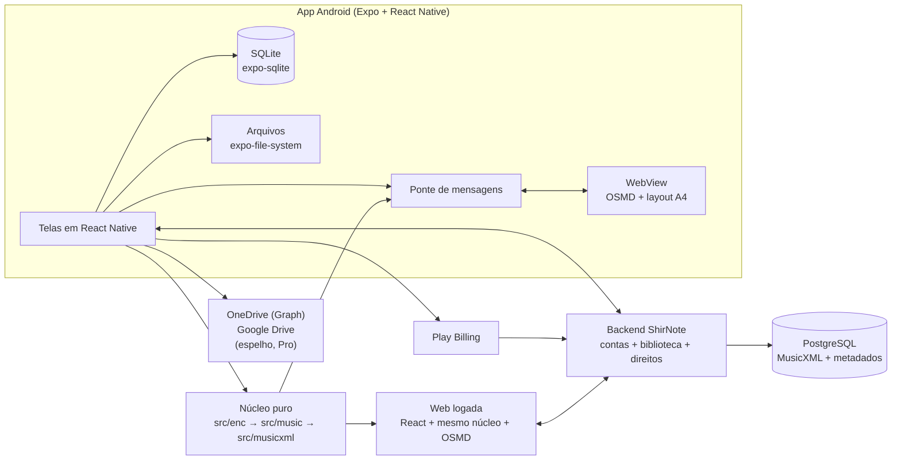

# PRD — App Móvel de Partituras ShirNote

- Versão: 2.1
- Data: 2026-11-08 (v1.0 em 2026-11-04; v1.1 em 2026-11-05; v2.0 e v2.1 em 2026-11-08)
- Decisores: Leonardo (Zappi), Benjamim (uso e prioridade), owner do produto
- v2.0: revisão do owner em 08/11/2026: conta ShirNote opcional (e-mail e senha, login com Google),
  biblioteca da conta no servidor em MusicXML, web com área logada, organização em pastas.
  OneDrive e Google Drive continuam como opção do Pro (ADRs 0009 e 0010).
- v2.1: respostas do owner às Q7 a Q10: e-mail por ambiente (ADR 0011), estudo de PDF para
  MusicXML, nome único sem duplicados (ADR 0012), Pro com 50 itens, pastas, etiquetas e setlists.
- Substitui como produto: [`PRD — Visualizador Web de Partituras Encore (.enc)`](../archive/PRD%20—%20Visualizador%20Web%20de%20Partituras%20Encore%20(.enc).md), que fica como registro do MVP web concluído.
- Como implementar: [`TECHSPEC — App Móvel ShirNote`](TECHSPEC%20—%20App%20Móvel%20ShirNote.md). Mapa dos documentos: [`docs/README.md`](README.md).

---

## 1. Visão geral e problema

O ShirNote nasceu como visualizador web de partituras `.enc` do Encore. O MVP cumpriu o objetivo:
abre o arquivo no navegador, converte para MusicXML e desenha no OSMD, sem enviar nada a servidor.

O uso real mostrou três limites do produto web:

1. **O PDF não existe.** Quem tem o acervo em `.enc` continua dependendo do Encore para gerar PDF e
   imprimir; é a maior dor relatada pelo usuário que testou o MVP.
2. **O celular e o tablet são o lugar de uso.** Músico lê partitura em pé, no ensaio, com o tablet na
   estante. Abrir um site, escolher arquivo e perder a sessão a cada recarga não serve.
3. **A biblioteca não existe.** Cada abertura é um arquivo solto; não há galeria, busca, favoritos
   nem sincronização entre aparelhos.

O produto passa a ser um **aplicativo Android mobile-first** de biblioteca e leitura de partituras,
com edição simples (transposição e metadados) e exportação em PDF/MusicXML. A leitura continua local
e offline.

Desde a v2.0, quem quiser cria uma **conta ShirNote**: a biblioteca passa a morar também no servidor,
em MusicXML, e aparece igual no app, na **web** e em outro aparelho. A conta é opcional no grátis e
obrigatória no Pro. OneDrive e Google Drive continuam como cópia na nuvem da própria pessoa.

### Por que agora

- O núcleo (`src/enc`, `src/music`, `src/musicxml`) está pronto, testado e sem DOM (RNF-05), então o
  app móvel reaproveita a parte mais cara do projeto.
- O OSMD é **BSD-3-Clause**, o que permite distribuí-lo num app pago sem abrir o código.
- O concorrente citado (leitor de PDF usado na Beit) tem pouca concorrência boa no Android e não lê
  `.enc` nem edita a partitura.

## 2. Objetivos, não-objetivos e métricas

**Objetivos da v1**

- Importar `.enc`, MusicXML e PDF para uma biblioteca local que funciona offline.
- Ler a partitura com zoom, rolagem e tela cheia; ler PDF com paginação.
- Transpor a partitura por semitons, com armadura e acidentes corretos.
- Exportar PDF paginado e MusicXML; imprimir pelo serviço de impressão do Android.
- Conta ShirNote opcional, com e-mail e senha ou Google (ADR 0009).
- Biblioteca da conta guardada no servidor em MusicXML e sincronizada com o app e a web (ADR 0010).
- Web com área logada: ver, organizar e, no Pro, transpor e exportar a mesma biblioteca.
- Organizar a biblioteca em pastas, etiquetas e setlists, iguais no app e na web.
- Não aceitar partitura duplicada: nome único na biblioteca (ADR 0012).
- Cópia opcional no OneDrive e no Google Drive para o Pro (ADR 0008).
- Vender o plano Pro com validação de compra no backend, vinculado à conta.
- Limitar o plano grátis a 8 partituras e à visualização.

**Não-objetivos da v1**

- Editor completo de partitura (inserir/remover notas, compassos, vozes, claves, dinâmicas). O
  MusicXML no servidor prepara essa evolução, mas ela não entra na v1.
- Reprodução de áudio/MIDI e cursor de reprodução.
- Layout idêntico ao Encore.
- Importar `.enc` de versões diferentes de `0xC4` (continua valendo o ADR 0002).
- iOS (fica para a v1.1, com o mesmo código).
- Compra do Pro pela web; na v1 o Pro é comprado só na Play Store e vale também na web.
- PDF guardado no servidor; o original fica no aparelho e na nuvem pessoal (ADR 0013).
- Corrigir dentro do ShirNote a partitura convertida de PDF (depende do editor futuro).
- Internacionalização além de pt-BR.

**Métricas propostas**

| Métrica | Meta |
| --- | --- |
| Partitura `.enc` de até 50 compassos aberta no tablet | ≤ 3 s até a primeira página desenhada |
| Exportação de PDF de 4 páginas | ≤ 5 s no mesmo tablet |
| Travamentos por arquivo inválido | 0 |
| Sincronização de 20 partituras pequenas | ≤ 30 s em 4G |
| Alteração no app aparece na web | ≤ 10 s com rede nos dois |
| Usuários ativos que criam conta (a confirmar) | ≥ 30% |
| Conversão do grátis para o Pro (a confirmar) | ≥ 3% dos usuários ativos |

## 3. Público-alvo e casos de uso

| Persona | Necessidade | Caso de uso principal |
| --- | --- | --- |
| Músico de igreja, banda ou orquestra | Ter o repertório no tablet e gerar PDF para o grupo | Importar o acervo `.enc`, organizar na galeria, transpor para o tom do vocal e exportar PDF |
| Professor ou regente | Adaptar a partitura ao instrumento/aluno | Abrir, subir/baixar um tom, imprimir ou compartilhar |
| Usuário que já tem PDFs | Um leitor só, com nuvem | Importar PDFs, sincronizar com OneDrive e ler offline |

## 4. Escopo da v1 (Android)

| Dentro | Fora |
| --- | --- |
| Android 10+ (API 29), foco em tablet de 8" a 13" | iOS e desktop |
| Biblioteca local em SQLite com busca e ordenação | Compartilhar partitura entre contas |
| Conta ShirNote opcional (e-mail e senha, Google) | Login com Apple, Microsoft ou outros |
| Biblioteca da conta no servidor em MusicXML, organizada em pastas, etiquetas e setlists | PDF guardado no servidor (só passa por lá para converter, ADR 0013) |
| Web logada com a mesma biblioteca; web sem login como demonstração | App de desktop |
| Importação `.enc`, `.musicxml`/`.xml` e `.pdf` | Importação de MIDI, MuseScore, `.mscz` |
| Leitura com zoom, rolagem, tela cheia e retomada de posição | Anotações à mão livre sobre a partitura |
| Transposição ± semitons e edição de título/autor | Edição nota a nota |
| Exportação PDF/MusicXML, impressão e compartilhamento | Exportação `.enc` |
| Cópia no OneDrive (pasta do app) e Google Drive (`drive.file`) para o Pro | Ler a biblioteca direto do OneDrive na web |
| Plano grátis (8 partituras, só leitura) e Pro | Anúncios |

## 5. Requisitos funcionais

| ID | Requisito | Prioridade |
| --- | --- | --- |
| RFM-01 | Importar `.enc` por seletor de arquivos e compartilhamento do Android, com processamento local | Alta |
| RFM-02 | Importar MusicXML (`.musicxml`, `.xml`) e exibir como partitura | Alta |
| RFM-03 | Importar PDF e exibir com paginação, zoom e rolagem; com conta, tentar converter para MusicXML, com aviso de possível erro e o PDF original sempre disponível (ADR 0013, [estudo](feature/pdf-para-musicxml.md)) | Alta |
| RFM-04 | Manter biblioteca local com capa/primeira página, título, autor, tipo e data; buscar e ordenar | Alta |
| RFM-05 | Visualizar partitura com zoom, rolagem, tela cheia e retomada da última posição | Alta |
| RFM-06 | Transpor a partitura por semitons (aumentar/diminuir), corrigindo armadura e acidentes | Alta |
| RFM-07 | Editar título e autor e renomear o item da biblioteca | Média |
| RFM-08 | Exportar PDF paginado (A4) e compartilhar | Alta |
| RFM-09 | Exportar MusicXML e compartilhar | Média |
| RFM-10 | Imprimir pelo serviço de impressão do Android | Média |
| RFM-11 | Copiar a biblioteca para o OneDrive na pasta do aplicativo e importar o que for colocado lá (Pro) | Média |
| RFM-12 | O mesmo do RFM-11 no Google Drive, escopo `drive.file` (Pro) | Baixa |
| RFM-13 | Aplicar os limites do plano: grátis até 8 itens e Pro até 50, no aparelho e na conta; no grátis, importar, ler, excluir e sincronizar com a conta, sem transpor, editar, exportar nem usar OneDrive/Google Drive (seção 7) | Alta |
| RFM-14 | Comprar o plano Pro pela Play Store, logado, e liberar os recursos após validação no backend, no app e na web | Alta |
| RFM-15 | Restaurar a compra em outro aparelho da mesma conta e revalidar o direito periodicamente | Alta |
| RFM-16 | Excluir item da biblioteca com confirmação e liberar o espaço | Média |
| RFM-17 | Avisar com clareza erro de arquivo, limite do plano, conflito de sincronização e compra | Alta |
| RFM-18 | Funcionar sem rede em tudo, exceto conta, sincronização e compra | Alta |
| RFM-19 | Criar conta e entrar com e-mail e senha ou com Google, no app e na web; verificar e-mail e recuperar senha ([feature](feature/contas.md)) | Alta |
| RFM-20 | Sincronizar automaticamente a biblioteca entre aparelho, servidor e web para quem tem conta, sem perder versão em conflito ([feature](feature/sincronizacao.md)) | Alta |
| RFM-21 | Organizar a biblioteca em pastas e subpastas, iguais no app e na web ([feature](feature/organizacao.md)) | Alta |
| RFM-22 | Ver, buscar, abrir e organizar a biblioteca da conta na web; no Pro, transpor, editar e exportar | Alta |
| RFM-23 | Excluir a conta pelo app e pela web, apagando os dados no servidor | Alta |
| RFM-24 | Marcar partituras com etiquetas e filtrar por elas | Média |
| RFM-25 | Montar setlists ordenadas e ler em sequência (anterior/próxima) | Alta |
| RFM-26 | Filtrar por pasta, etiqueta, tipo e tom; recentes e favoritas | Média |
| RFM-27 | Recusar partitura duplicada (mesmo nome ou mesmo conteúdo); se a pessoa aceitar, numerar o nome ("Nome 1") (ADR 0012) | Alta |

## 6. Requisitos não funcionais

| ID | Categoria | Requisito |
| --- | --- | --- |
| RNFM-01 | Offline-first | Biblioteca, leitura, transposição e exportação funcionam sem rede; só conta, sincronização e compra dependem dela |
| RNFM-02 | Privacidade | Sem conta, nenhum arquivo sai do aparelho. Com conta, a biblioteca vai só para o servidor do ShirNote, na conta da própria pessoa, e para a nuvem pessoal que ela conectar. Nenhuma outra saída |
| RNFM-03 | Desempenho | 50 compassos em até 3 s e PDF de 4 páginas em até 5 s no tablet de referência (a definir) |
| RNFM-04 | Compatibilidade | Android 10+ (API 29), arm64-v8a, tablets de 8" a 13" |
| RNFM-05 | Manutenibilidade | `src/enc`, `src/music` e `src/musicxml` continuam sem React Native, DOM ou APIs de plataforma |
| RNFM-06 | Testabilidade | Núcleo testado em Node; fluxos do app com teste de fumaça em aparelho/emulador antes de cada release |
| RNFM-07 | Acessibilidade | TalkBack nos controles, contraste e alvos de toque de 48 dp; o conteúdo da WebView tem nome acessível |
| RNFM-08 | Idioma | Interface em português do Brasil |
| RNFM-09 | Segurança | O app nunca libera o Pro só com uma resposta local; o direito vem assinado pelo backend |
| RNFM-10 | Distribuição | Tamanho do APK/AAB ≤ 80 MB e abertura do app ≤ 3 s em aparelho médio |
| RNFM-11 | Segurança da conta | HTTPS em tudo; senha só como hash; limite de tentativas; toda consulta do servidor filtrada pelo dono da sessão; backup diário do banco com restauração testada |
| RNFM-12 | Conformidade | Política de privacidade (LGPD) e exclusão de conta conforme a Play Store antes da publicação |

## 7. Modelo de negócio e limites do plano

| Recurso | Grátis sem conta | Grátis com conta | Pro (exige conta) |
| --- | --- | --- | --- |
| Itens na biblioteca | Até 8, no aparelho | Até 8, no aparelho e na conta | Até 50 (inicial; planos maiores depois) |
| Biblioteca na web e em outro aparelho | Não | Sim | Sim |
| Pastas, etiquetas, setlists, favoritas | Sim, no aparelho | Sim | Sim |
| Leitura, zoom e tela cheia | Sim | Sim | Sim |
| Importar `.enc`, MusicXML e PDF | Sim, até o limite | Sim, até o limite | Sim |
| Transpor e editar metadados | Não | Não | Sim |
| Exportar PDF/MusicXML e imprimir | Não | Não | Sim |
| Cópia no OneDrive/Google Drive | Não | Não | Sim |
| Excluir item | Sim | Sim | Sim |

Regras:

1. O limite conta **itens na biblioteca**, independentemente do tipo. Excluir libera vaga. Com
   conta, o servidor aplica o mesmo limite.
2. O grátis nunca perde acesso ao que já importou. Quem volta do Pro para o grátis (cancelamento,
   reembolso ou fim da carência) com mais de 8 itens mantém todos legíveis e excluíveis; só a
   importação fica bloqueada até a biblioteca voltar a ter menos de 8 itens. Nada é apagado.
3. A compra é uma assinatura ou compra única definida no Play Console; o código não fixa preço.
4. O direito é revalidado no backend. Offline, o app usa um direito assinado com validade curta
   (proposta: 14 dias de carência) e revalida quando voltar a ter rede.
5. Reembolso ou cancelamento revoga o Pro no próximo contato com o backend, respeitando a carência.
6. O Pro pertence à conta, não ao aparelho: vale no app, na web e em qualquer aparelho logado.
   O limite inicial do Pro é 50 itens, para caber na infraestrutura do começo. Planos com mais espaço
   virão depois, conforme o custo de manter o servidor. Quem passa do limite segue a mesma regra 2:
   tudo continua legível, só importar fica bloqueado.
7. A conta nunca é obrigatória para importar e ler no aparelho.

## 8. Arquitetura e stack

- **App:** Expo (React Native) + TypeScript, Android primeiro. A UI é nativa; só a partitura é
  desenhada numa WebView, porque o OSMD depende de DOM/SVG (ADR 0005).
- **Núcleo compartilhado:** os três diretórios continuam puros e entram no app sem cópia, via Metro
  com `watchFolders` no repositório (ADR 0005).
- **Persistência:** SQLite para metadados e MusicXML; PDFs ficam como arquivo no diretório do app
  (ADR 0006).
- **Backend:** Node 22 + Fastify + PostgreSQL (ADR 0007). Contas com Better Auth (ADR 0009);
  biblioteca da conta em MusicXML no mesmo banco (ADR 0010).
- **Web:** o site atual ganha área logada com a biblioteca da conta, usando o mesmo núcleo e o OSMD.
  Sem login, continua como demonstração local.
- **Nuvem pessoal:** Microsoft Graph e Google Drive API, OAuth 2.0 com PKCE, escopos mínimos
  (ADR 0008); com conta, espelho da biblioteca.
- **Cobrança:** Play Billing no app, validação no backend com a Google Play Developer API, banco de
  direitos e notificações em tempo real (ADR 0007), com o direito vinculado à conta (ADR 0009).
- **Exportação:** o visualizador renderiza em páginas A4 e devolve os SVGs; o app monta o HTML e usa
  `expo-print` para gerar o PDF e `expo-sharing` para compartilhar.

## 9. Persistência e formato

O formato canônico da partitura é **MusicXML**, no aparelho e no servidor. O banco guarda metadados
e o XML; o arquivo original `.enc` não é necessário depois da importação e não vai ao servidor. O
MusicXML no servidor é a base do editor avançado futuro.

| Origem | O que fica guardado | Pode transpor? |
| --- | --- | --- |
| `.enc` | MusicXML gerado + modelo neutro (`Score` em JSON) | Sim, na v1 |
| MusicXML | XML original | Não na v1 (exige importador para o modelo neutro) |
| PDF | Arquivo PDF no diretório do app + caminho no banco | Não |

Tabelas iniciais (migrações versionadas):

- `scores`: `id`, `title`, `composer`, `kind` (`enc`/`musicxml`/`pdf`), `musicxml`, `score_json`,
  `file_uri`, `page_count`, `transposition`, `created_at`, `updated_at`.
- `sync_state`: `score_id`, `provider`, `remote_id`, `etag`, `content_hash`, `synced_at`.
- `entitlement`: uma linha com `plan`, `expires_at`, `source`, `token`, `checked_at`.
- `settings`: preferências e última posição de leitura.

## 10. Fluxos principais

**Importar `.enc`**

1. Seletor de arquivos ou "Abrir com" do Android entrega o arquivo ao app.
2. O app lê o `ArrayBuffer`, valida o cabeçalho e chama `parseEncore`.
3. Gera o MusicXML e guarda XML + modelo neutro no SQLite.
4. A biblioteca atualiza e o item abre no visualizador.
5. Arquivo inválido mostra a mensagem do `EncoreFormatError` e não entra na biblioteca (RFM-17).

**Transpor**

1. No visualizador, o usuário toca em −/+ semitom.
2. O app soma o passo ao total (`transposition`, limite de ±12), aplica `transposeScore` sobre o
   modelo neutro **original** com esse total, regenera o MusicXML e atualiza o banco. O modelo salvo
   nunca é o transposto, então subir e descer volta à grafia exata do arquivo.
3. O visualizador redesenha; a biblioteca mostra o tom atual.
4. Se o item veio de MusicXML ou PDF, o controle aparece desabilitado com a explicação.

**Exportar PDF**

1. O app pede ao visualizador a versão em páginas A4.
2. O visualizador renderiza com `pageFormat: "A4 P"` e devolve um SVG por página.
3. O app monta o HTML, chama `expo-print` e compartilha o arquivo.
4. No grátis, a ação é bloqueada com a oferta do Pro.

**Entrar e sincronizar com a conta** ([contas](feature/contas.md), [sincronização](feature/sincronizacao.md))

1. A pessoa cria conta ou entra (e-mail e senha ou Google). As partituras do aparelho sobem para a
   conta, respeitando o limite do grátis.
2. Daí em diante, cada alteração é enviada assim que houver rede, e o app recebe o que mudou na web
   ou em outro aparelho ao abrir e ao voltar a ter rede.
3. Mesmo item alterado em dois lugares: as duas versões ficam, uma com "(conflito)", e a pessoa é
   avisada.

**Copiar para o OneDrive / Google Drive (Pro, ADR 0008)**

1. O usuário conecta a conta do provedor (OAuth com PKCE) e escolhe "Sincronizar".
2. O app compara o hash local e o remoto com o `content_hash` da última sincronização
   (`sync_state`): só o local mudou, envia; só o remoto mudou, baixa; nenhum mudou, ignora. O
   `updated_at` serve só para exibir, porque o relógio de cada aparelho pode estar errado.
3. Os dois lados mudaram: mantém as duas versões, a remota com sufixo "(conflito)", e avisa.
4. A sincronização é manual na v1; automática em segundo plano fica para a v1.1.

## 11. Critérios de aceite da v1

1. Um `.enc` real do acervo abre no tablet e desenha a partitura completa.
2. Um PDF importado abre, pagina e mantém a posição ao voltar para a biblioteca.
3. Subir e descer um semitom mantém a melodia reconhecível e a armadura correta; o MusicXML
   exportado abre no MuseScore.
4. O PDF exportado tem páginas A4, sem compasso cortado, e abre em qualquer leitor.
5. O app funciona em modo avião: importa, lê, transpõe e exporta.
6. O grátis para de importar no nono item e explica como liberar.
7. A compra libera o Pro; reinstalar e restaurar mantém o direito; reembolso revoga.
8. A cópia no OneDrive recebe a biblioteca e importa o que for colocado na pasta, sem perder arquivo.
9. Sem conta, nenhum arquivo sai do aparelho. Com conta, só para o servidor do ShirNote e para a
   nuvem pessoal conectada.
10. Criar conta no app, importar uma partitura e vê-la na web em até 10 s; renomear na web e ver no
    app.
11. Entrar com Google e com e-mail e senha cai na mesma conta; recuperar a senha funciona.
12. Excluir a conta pelo app e pela web apaga os dados no servidor.

## 12. Fases e marcos

| Fase | Entrega | Portão |
| --- | --- | --- |
| 6 — Fundação | Estrutura do app, núcleo compartilhado, SQLite, biblioteca e importação `.enc` | G6: biblioteca abre e lê `.enc` no tablet |
| 7 — Leitura e edição | WebView com OSMD, zoom, transposição, metadados e retomada de posição | G7: transpor e ler no tablet |
| 8 — Exportação | PDF paginado, MusicXML, impressão e compartilhamento | G8: PDF sem compasso cortado |
| 9 — Contas e sincronização | Backend no ar, contas (e-mail e senha, Google), biblioteca da conta em MusicXML, sincronização do app, excluir conta | G9: importar no app, ver em outro aparelho; conflito sem perda |
| 10 — Web logada | Área logada no site: biblioteca, pastas, leitura, transposição e exportação no Pro | G10: alteração no app aparece na web e vice-versa |
| 11 — Cobrança | Play Billing, direito por conta, RTDN e limites do grátis no servidor | G11: compra no app vale na web; restauração e reembolso |
| 12 — Nuvem pessoal | OneDrive e Google Drive como espelho da conta (Pro) | G12: ida e volta sem perda |
| 13 — Release | Testes em aparelho, política de privacidade, exclusão de conta, ficha da loja e beta fechado | G13: beta aprovado |

A ordem 9 → 13 é proposta da v2.0: contas vêm antes da cobrança porque o Pro exige conta. Datas serão
definidas depois do G7; o cronograma web não se aplica a este produto.

## 13. Riscos, premissas e questões em aberto

| Risco / questão | Impacto | Mitigação |
| --- | --- | --- |
| OSMD em WebView no Android médio | Lentidão e memória | Renderização incremental do OSMD, páginas sob demanda e medição no G7 |
| Regra 4.2 da Play Store ("app que é só site") | Reprovação | O app tem biblioteca offline, edição, exportação, nuvem e compra; a WebView é só o renderizador |
| Backend de contas, biblioteca e direitos | Custo, operação e responsabilidade por dados pessoais (LGPD) | Serviço único com banco gerenciado, backup diário testado, mínimo de dados (ADRs 0007, 0009, 0010) |
| Biblioteca no servidor cresce | Custo do banco | Medir por usuário; limite de 5 MB por item; object storage só se precisar (ADR 0010) |
| Conta de desenvolvedor e do Azure/Google | Bloqueio externo | Iniciar os cadastros antes da Fase 9 |
| Direitos das partituras reais | Jurídico | Confirmar o direito de uso antes de publicar exemplos |
| PDF importado com DRM/senha | Não abre | Avisar e recusar com mensagem clara |
| Transposição de MusicXML importado | Recurso incompleto | Declarar como limitação da v1 e planejar o importador no backlog |
| Play Console: conta pessoal nova exige teste fechado antes da produção (hoje, 12 testadores por 14 dias; confirmar a regra vigente) | Atraso na Fase 11 | Recrutar testadores na Beit durante a Fase 9 e abrir o teste fechado assim que o G7 passar |
| OneDrive de conta organizacional (Microsoft 365) | Consentimento do administrador do tenant | Confirmar o tipo de conta da Beit antes da Fase 9 e registrar o app como multilocatário |
| Tablet de referência indefinido | Metas de RNFM-03 sem medida | Escolher o aparelho antes do G6 e registrar num ADR, como no ADR 0004 |

### Questões em aberto com o dono do produto

Origem: conversa de 04/11/2026 que motivou o pivô e revisão do owner em 08/11/2026. Até a resposta,
vale o escopo das seções 2 e 4.

| # | Pergunta | Por que importa |
| --- | --- | --- |
| Q1 | "Edição de arquivo `.enc`" é transpor, corrigir notas ou salvar de volta para abrir no Encore? | Gravar `.enc` exige o formato de escrita, hoje não comprovado; edição nota a nota está fora da v1 |
| Q2 | Qual app de leitura de PDF a Beit usa hoje e o que nele é indispensável (setlist, virada por pedal Bluetooth, anotações)? | "Igual ao que usamos" define o mínimo da leitura; anotações estão fora da v1 |
| Q3 | O OneDrive da Beit é conta pessoal ou Microsoft 365? | Muda o registro do app e o consentimento (ADR 0008) |
| Q4 | ~~Exportar PDF e transpor no site atual, antes do app, resolve a dor imediata do Almir?~~ | **Respondida:** o site já transpõe e imprime/salva PDF (README, estado atual) |
| Q5 | ~~O web e o app vão ser o mesmo produto?~~ | **Respondida em 08/11/2026:** sim, com conta; v2.0 e ADR 0010 |
| Q6 | ~~Haverá contas?~~ | **Respondida em 08/11/2026:** e-mail e senha + Google, opcional no grátis, obrigatória no Pro (ADR 0009) |
| Q7 | ~~Qual serviço envia os e-mails?~~ | **Respondida:** Mailpit local, Mailtrap em staging, Resend ou Brevo em produção (ADR 0011). Falta escolher entre Resend e Brevo e o domínio de envio |
| Q8 | ~~PDF importado deve ir para o servidor e aparecer na web?~~ | **Respondida em 08/11/2026:** conversão opcional, a cargo de quem importa, com aviso; o PDF original fica no aparelho e no OneDrive/Google Drive; o servidor guarda só o MusicXML (ADR 0013) |
| Q9 | ~~Qual cota no Pro?~~ | **Respondida:** 50 itens no início; planos maiores depois, conforme a infraestrutura |
| Q10 | ~~Organizar é só pasta?~~ | **Respondida:** pastas, etiquetas, setlists e o que ajudar a navegar ([feature](feature/organizacao.md)) |
| Q11 | Preço e nomes dos planos maiores que o Pro de 50 itens | Depende do custo medido da infraestrutura depois da Fase 9 |
