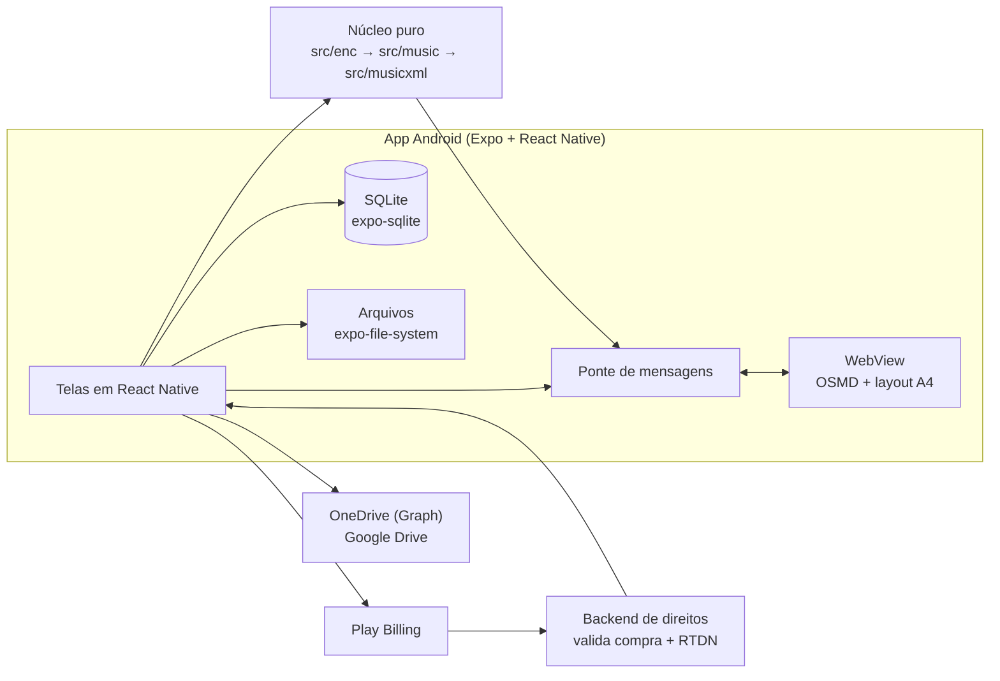

# PRD — App Móvel de Partituras ShirNote

- Versão: 1.1
- Data: 2026-11-05 (v1.0 em 2026-11-04)
- Decisores: Leonardo (Zappi), Benjamim (uso e prioridade)
- Substitui como produto: [`PRD — Visualizador Web de Partituras Encore (.enc)`](../archive/PRD%20—%20Visualizador%20Web%20de%20Partituras%20Encore%20(.enc).md), que fica como registro do MVP web concluído.
- Como implementar: [`TECHSPEC — App Móvel ShirNote`](TECHSPEC%20—%20App%20Móvel%20ShirNote.md). Mapa dos documentos: [`docs/README.md`](README.md).

---

## 1. Visão geral e problema

O ShirNote nasceu como visualizador web de partituras `.enc` do Encore. O MVP cumpriu o objetivo:
abre o arquivo no navegador, converte para MusicXML e desenha no OSMD, sem enviar nada a servidor.

O uso real mostrou três limites do produto web:

1. **O PDF não existe.** Quem tem o acervo em `.enc` continua dependendo do Encore para gerar PDF e
   imprimir; é a maior dor relatada pelo usuário que testou o MVP.
2. **O celular e o tablet são o lugar de uso.** Músico lê partitura em pé, no ensaio, com o tablet na
   estante. Abrir um site, escolher arquivo e perder a sessão a cada recarga não serve.
3. **A biblioteca não existe.** Cada abertura é um arquivo solto; não há galeria, busca, favoritos
   nem sincronização entre aparelhos.

O produto passa a ser um **aplicativo Android mobile-first** de biblioteca e leitura de partituras,
com edição simples (transposição e metadados), exportação em PDF/MusicXML e sincronização com
OneDrive (foco) e Google Drive. A leitura continua local e offline; a nuvem é uma ação explícita do
usuário.

### Por que agora

- O núcleo (`src/enc`, `src/music`, `src/musicxml`) está pronto, testado e sem DOM (RNF-05), então o
  app móvel reaproveita a parte mais cara do projeto.
- O OSMD é **BSD-3-Clause**, o que permite distribuí-lo num app pago sem abrir o código.
- O concorrente citado (leitor de PDF usado na Beit) tem pouca concorrência boa no Android e não lê
  `.enc` nem edita a partitura.

## 2. Objetivos, não-objetivos e métricas

**Objetivos da v1**

- Importar `.enc`, MusicXML e PDF para uma biblioteca local que funciona offline.
- Ler a partitura com zoom, rolagem e tela cheia; ler PDF com paginação.
- Transpor a partitura por semitons, com armadura e acidentes corretos.
- Exportar PDF paginado e MusicXML; imprimir pelo serviço de impressão do Android.
- Sincronizar a biblioteca com OneDrive e Google Drive, sem servidor próprio de arquivos.
- Vender o plano Pro com validação de compra no backend.
- Limitar o plano grátis a 8 partituras e à visualização.

**Não-objetivos da v1**

- Editor completo de partitura (inserir/remover notas, compassos, vozes, claves, dinâmicas).
- Reprodução de áudio/MIDI e cursor de reprodução.
- Layout idêntico ao Encore.
- Importar `.enc` de versões diferentes de `0xC4` (continua valendo o ADR 0002).
- iOS (fica para a v1.1, com o mesmo código).
- Versão web do produto; o site atual continua só como demonstração.
- Internacionalização além de pt-BR.

**Métricas propostas**

| Métrica | Meta |
| --- | --- |
| Partitura `.enc` de até 50 compassos aberta no tablet | ≤ 3 s até a primeira página desenhada |
| Exportação de PDF de 4 páginas | ≤ 5 s no mesmo tablet |
| Travamentos por arquivo inválido | 0 |
| Sincronização de 20 partituras pequenas | ≤ 30 s em 4G |
| Conversão do grátis para o Pro (a confirmar) | ≥ 3% dos usuários ativos |

## 3. Público-alvo e casos de uso

| Persona | Necessidade | Caso de uso principal |
| --- | --- | --- |
| Músico de igreja, banda ou orquestra | Ter o repertório no tablet e gerar PDF para o grupo | Importar o acervo `.enc`, organizar na galeria, transpor para o tom do vocal e exportar PDF |
| Professor ou regente | Adaptar a partitura ao instrumento/aluno | Abrir, subir/baixar um tom, imprimir ou compartilhar |
| Usuário que já tem PDFs | Um leitor só, com nuvem | Importar PDFs, sincronizar com OneDrive e ler offline |

## 4. Escopo da v1 (Android)

| Dentro | Fora |
| --- | --- |
| Android 10+ (API 29), foco em tablet de 8" a 13" | iOS, web e desktop |
| Biblioteca local em SQLite com busca e ordenação | Contas próprias do ShirNote (login) |
| Importação `.enc`, `.musicxml`/`.xml` e `.pdf` | Importação de MIDI, MuseScore, `.mscz` |
| Leitura com zoom, rolagem, tela cheia e retomada de posição | Anotações à mão livre sobre a partitura |
| Transposição ± semitons e edição de título/autor | Edição nota a nota |
| Exportação PDF/MusicXML, impressão e compartilhamento | Exportação `.enc` |
| Sincronização OneDrive (pasta do app) e Google Drive (`drive.file`) | Servidor próprio de arquivos |
| Plano grátis (8 partituras, só leitura) e Pro | Anúncios |

## 5. Requisitos funcionais

| ID | Requisito | Prioridade |
| --- | --- | --- |
| RFM-01 | Importar `.enc` por seletor de arquivos e compartilhamento do Android, com processamento local | Alta |
| RFM-02 | Importar MusicXML (`.musicxml`, `.xml`) e exibir como partitura | Alta |
| RFM-03 | Importar PDF e exibir com paginação, zoom e rolagem | Alta |
| RFM-04 | Manter biblioteca local com capa/primeira página, título, autor, tipo e data; buscar e ordenar | Alta |
| RFM-05 | Visualizar partitura com zoom, rolagem, tela cheia e retomada da última posição | Alta |
| RFM-06 | Transpor a partitura por semitons (aumentar/diminuir), corrigindo armadura e acidentes | Alta |
| RFM-07 | Editar título e autor e renomear o item da biblioteca | Média |
| RFM-08 | Exportar PDF paginado (A4) e compartilhar | Alta |
| RFM-09 | Exportar MusicXML e compartilhar | Média |
| RFM-10 | Imprimir pelo serviço de impressão do Android | Média |
| RFM-11 | Sincronizar com OneDrive na pasta do aplicativo, com envio e recebimento | Alta |
| RFM-12 | Sincronizar com Google Drive no escopo `drive.file` | Média |
| RFM-13 | Aplicar o limite do grátis: até 8 itens na biblioteca; importar, ler e excluir, sem transpor, editar, exportar nem sincronizar (seção 7) | Alta |
| RFM-14 | Comprar o plano Pro pela Play Store e liberar os recursos após validação no backend | Alta |
| RFM-15 | Restaurar a compra em outro aparelho e revalidar o direito periodicamente | Alta |
| RFM-16 | Excluir item da biblioteca com confirmação e liberar o espaço | Média |
| RFM-17 | Avisar com clareza erro de arquivo, limite do plano, conflito de sincronização e compra | Alta |
| RFM-18 | Funcionar sem rede em tudo, exceto sincronização e compra | Alta |

## 6. Requisitos não funcionais

| ID | Categoria | Requisito |
| --- | --- | --- |
| RNFM-01 | Offline-first | Biblioteca, leitura, transposição e exportação funcionam sem rede; só a nuvem e a compra dependem dela |
| RNFM-02 | Privacidade | Nenhum arquivo sai do aparelho sem ação explícita do usuário; a sincronização vai só para a conta dele |
| RNFM-03 | Desempenho | 50 compassos em até 3 s e PDF de 4 páginas em até 5 s no tablet de referência (a definir) |
| RNFM-04 | Compatibilidade | Android 10+ (API 29), arm64-v8a, tablets de 8" a 13" |
| RNFM-05 | Manutenibilidade | `src/enc`, `src/music` e `src/musicxml` continuam sem React Native, DOM ou APIs de plataforma |
| RNFM-06 | Testabilidade | Núcleo testado em Node; fluxos do app com teste de fumaça em aparelho/emulador antes de cada release |
| RNFM-07 | Acessibilidade | TalkBack nos controles, contraste e alvos de toque de 48 dp; o conteúdo da WebView tem nome acessível |
| RNFM-08 | Idioma | Interface em português do Brasil |
| RNFM-09 | Segurança | O app nunca libera o Pro só com uma resposta local; o direito vem assinado pelo backend |
| RNFM-10 | Distribuição | Tamanho do APK/AAB ≤ 80 MB e abertura do app ≤ 3 s em aparelho médio |

## 7. Modelo de negócio e limites do plano

| Recurso | Grátis | Pro |
| --- | --- | --- |
| Itens na biblioteca | Até 8 | Ilimitado |
| Leitura, zoom e tela cheia | Sim | Sim |
| Importar `.enc`, MusicXML e PDF | Sim, até o limite | Sim |
| Transpor e editar metadados | Não | Sim |
| Exportar PDF/MusicXML e imprimir | Não | Sim |
| Sincronizar OneDrive/Google Drive | Não | Sim |
| Excluir item | Sim | Sim |

Regras:

1. O limite conta **itens na biblioteca**, independentemente do tipo. Excluir libera vaga.
2. O grátis nunca perde acesso ao que já importou. Quem volta do Pro para o grátis (cancelamento,
   reembolso ou fim da carência) com mais de 8 itens mantém todos legíveis e excluíveis; só a
   importação fica bloqueada até a biblioteca voltar a ter menos de 8 itens. Nada é apagado.
3. A compra é uma assinatura ou compra única definida no Play Console; o código não fixa preço.
4. O direito é revalidado no backend. Offline, o app usa um direito assinado com validade curta
   (proposta: 14 dias de carência) e revalida quando voltar a ter rede.
5. Reembolso ou cancelamento revoga o Pro no próximo contato com o backend, respeitando a carência.

## 8. Arquitetura e stack

- **App:** Expo (React Native) + TypeScript, Android primeiro. A UI é nativa; só a partitura é
  desenhada numa WebView, porque o OSMD depende de DOM/SVG (ADR 0005).
- **Núcleo compartilhado:** os três diretórios continuam puros e entram no app sem cópia, via Metro
  com `watchFolders` no repositório (ADR 0005).
- **Persistência:** SQLite para metadados e MusicXML; PDFs ficam como arquivo no diretório do app
  (ADR 0006).
- **Nuvem:** Microsoft Graph e Google Drive API, OAuth 2.0 com PKCE, escopos mínimos (ADR 0008).
- **Cobrança:** Play Billing no app, validação no backend com a Google Play Developer API, banco de
  direitos e notificações em tempo real (ADR 0007).
- **Exportação:** o visualizador renderiza em páginas A4 e devolve os SVGs; o app monta o HTML e usa
  `expo-print` para gerar o PDF e `expo-sharing` para compartilhar.

## 9. Persistência e formato

O formato canônico da partitura é **MusicXML**. O banco guarda metadados e o XML; o arquivo original
`.enc` não é necessário depois da importação.

| Origem | O que fica guardado | Pode transpor? |
| --- | --- | --- |
| `.enc` | MusicXML gerado + modelo neutro (`Score` em JSON) | Sim, na v1 |
| MusicXML | XML original | Não na v1 (exige importador para o modelo neutro) |
| PDF | Arquivo PDF no diretório do app + caminho no banco | Não |

Tabelas iniciais (migrações versionadas):

- `scores`: `id`, `title`, `composer`, `kind` (`enc`/`musicxml`/`pdf`), `musicxml`, `score_json`,
  `file_uri`, `page_count`, `transposition`, `created_at`, `updated_at`.
- `sync_state`: `score_id`, `provider`, `remote_id`, `etag`, `content_hash`, `synced_at`.
- `entitlement`: uma linha com `plan`, `expires_at`, `source`, `token`, `checked_at`.
- `settings`: preferências e última posição de leitura.

## 10. Fluxos principais

**Importar `.enc`**

1. Seletor de arquivos ou "Abrir com" do Android entrega o arquivo ao app.
2. O app lê o `ArrayBuffer`, valida o cabeçalho e chama `parseEncore`.
3. Gera o MusicXML e guarda XML + modelo neutro no SQLite.
4. A biblioteca atualiza e o item abre no visualizador.
5. Arquivo inválido mostra a mensagem do `EncoreFormatError` e não entra na biblioteca (RFM-17).

**Transpor**

1. No visualizador, o usuário toca em −/+ semitom.
2. O app soma o passo ao total (`transposition`, limite de ±12), aplica `transposeScore` sobre o
   modelo neutro **original** com esse total, regenera o MusicXML e atualiza o banco. O modelo salvo
   nunca é o transposto, então subir e descer volta à grafia exata do arquivo.
3. O visualizador redesenha; a biblioteca mostra o tom atual.
4. Se o item veio de MusicXML ou PDF, o controle aparece desabilitado com a explicação.

**Exportar PDF**

1. O app pede ao visualizador a versão em páginas A4.
2. O visualizador renderiza com `pageFormat: "A4 P"` e devolve um SVG por página.
3. O app monta o HTML, chama `expo-print` e compartilha o arquivo.
4. No grátis, a ação é bloqueada com a oferta do Pro.

**Sincronizar**

1. O usuário conecta a conta (OAuth com PKCE) e escolhe "Sincronizar".
2. O app compara o hash local e o remoto com o `content_hash` da última sincronização
   (`sync_state`): só o local mudou, envia; só o remoto mudou, baixa; nenhum mudou, ignora. O
   `updated_at` serve só para exibir, porque o relógio de cada aparelho pode estar errado.
3. Os dois lados mudaram: mantém as duas versões, a remota com sufixo "(conflito)", e avisa.
4. A sincronização é manual na v1; automática em segundo plano fica para a v1.1.

## 11. Critérios de aceite da v1

1. Um `.enc` real do acervo abre no tablet e desenha a partitura completa.
2. Um PDF importado abre, pagina e mantém a posição ao voltar para a biblioteca.
3. Subir e descer um semitom mantém a melodia reconhecível e a armadura correta; o MusicXML
   exportado abre no MuseScore.
4. O PDF exportado tem páginas A4, sem compasso cortado, e abre em qualquer leitor.
5. O app funciona em modo avião: importa, lê, transpõe e exporta.
6. O grátis para de importar no nono item e explica como liberar.
7. A compra libera o Pro; reinstalar e restaurar mantém o direito; reembolso revoga.
8. A sincronização com OneDrive sobe e desce a biblioteca sem perder arquivo.
9. Nenhum arquivo é enviado a servidor que não seja a nuvem escolhida pelo usuário.

## 12. Fases e marcos

| Fase | Entrega | Portão |
| --- | --- | --- |
| 6 — Fundação | Estrutura do app, núcleo compartilhado, SQLite, biblioteca e importação `.enc` | G6: biblioteca abre e lê `.enc` no tablet |
| 7 — Leitura e edição | WebView com OSMD, zoom, transposição, metadados e retomada de posição | G7: transpor e ler no tablet |
| 8 — Exportação | PDF paginado, MusicXML, impressão e compartilhamento | G8: PDF sem compasso cortado |
| 9 — Nuvem | OneDrive e Google Drive, conflitos e estado de sincronização | G9: ida e volta sem perda |
| 10 — Cobrança | Play Billing, backend de direitos, RTDN e limites do grátis | G10: compra, restauração e reembolso |
| 11 — Release | Testes em aparelho, política de privacidade, ficha da loja e beta fechado | G11: beta aprovado |

Datas serão definidas depois do G6; o cronograma web não se aplica a este produto.

## 13. Riscos, premissas e questões em aberto

| Risco / questão | Impacto | Mitigação |
| --- | --- | --- |
| OSMD em WebView no Android médio | Lentidão e memória | Renderização incremental do OSMD, páginas sob demanda e medição no G7 |
| Regra 4.2 da Play Store ("app que é só site") | Reprovação | O app tem biblioteca offline, edição, exportação, nuvem e compra; a WebView é só o renderizador |
| Backend de direitos | Custo e operação | Serviço pequeno, com banco gerenciado; contrato definido no ADR 0007 |
| Conta de desenvolvedor e do Azure/Google | Bloqueio externo | Iniciar os cadastros antes da Fase 9 |
| Direitos das partituras reais | Jurídico | Confirmar o direito de uso antes de publicar exemplos |
| PDF importado com DRM/senha | Não abre | Avisar e recusar com mensagem clara |
| Transposição de MusicXML importado | Recurso incompleto | Declarar como limitação da v1 e planejar o importador no backlog |
| Play Console: conta pessoal nova exige teste fechado antes da produção (hoje, 12 testadores por 14 dias; confirmar a regra vigente) | Atraso na Fase 11 | Recrutar testadores na Beit durante a Fase 9 e abrir o teste fechado assim que o G7 passar |
| OneDrive de conta organizacional (Microsoft 365) | Consentimento do administrador do tenant | Confirmar o tipo de conta da Beit antes da Fase 9 e registrar o app como multilocatário |
| Tablet de referência indefinido | Metas de RNFM-03 sem medida | Escolher o aparelho antes do G6 e registrar num ADR, como no ADR 0004 |

### Questões em aberto com o dono do produto

Origem: conversa de 04/11/2026 que motivou o pivô. Até a resposta, vale o escopo das seções 2 e 4.

| # | Pergunta | Por que importa |
| --- | --- | --- |
| Q1 | "Edição de arquivo `.enc`" é transpor, corrigir notas ou salvar de volta para abrir no Encore? | Gravar `.enc` exige o formato de escrita, hoje não comprovado; edição nota a nota está fora da v1 |
| Q2 | Qual app de leitura de PDF a Beit usa hoje e o que nele é indispensável (setlist, virada por pedal Bluetooth, anotações)? | "Igual ao que usamos" define o mínimo da leitura; anotações estão fora da v1 |
| Q3 | O OneDrive da Beit é conta pessoal ou Microsoft 365? | Muda o registro do app e o consentimento (ADR 0008) |
| Q4 | Exportar PDF e transpor no site atual, antes do app, resolve a dor imediata do Almir? | Entrega o pedido original em dias em vez de esperar a Fase 8 |
