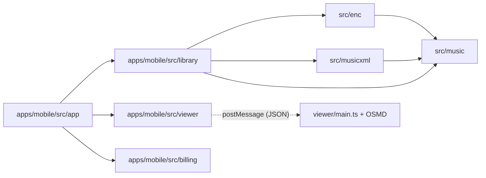

# TECHSPEC — App Móvel ShirNote

- Versão: 1.1
- Data: 2026-11-08 (v1.0 em 2026-11-05; v1.1: fases e requisitos do PRD v2.0)
- Responsável: Leonardo (Zappi)
- Produto: [PRD do app móvel](PRD%20—%20App%20Móvel%20de%20Partituras%20ShirNote.md) (o quê e por quê)
- Decisões: [ADRs 0005 a 0012](decisions/README.md) (por que esta forma)
- Formato `.enc`: [`enc-format.md`](enc-format.md) (o que está comprovado)

Este documento diz **como** o app é construído e **o que já existe no código**. Quando ele e o código
divergirem, o código vale e este documento deve ser corrigido na mesma alteração. Requisitos (RFM,
RNFM) são definidos só no PRD; aqui eles são apenas citados.

---

## 1. Estado por requisito

Legenda: **feito** = no código; **parcial** = parte do requisito no código;
**planejado** = sem código ainda. Os fluxos de G6 e G7 passaram no teste de fumaça do tablet em 06/11/2026 (§9); o fechamento formal dos portões ainda não foi registrado.

| Requisito | Estado | Onde |
| --- | --- | --- |
| RFM-01 Importar `.enc` pelo seletor | feito | `library/importFile.ts`, `library/importScore.ts` |
| RFM-01 Importar pelo "Abrir com" do Android | planejado | intent filter no `app.json` (Fase 6) |
| RFM-02 Importar MusicXML | feito, sem modelo neutro | `convertMusicXml` |
| RFM-03 Importar e ler PDF | planejado | §6.4 |
| RFM-04 Biblioteca com busca e ordenação ([feature](feature/biblioteca.md)) | feito, sem capa | `library/format.ts`, `app/index.tsx` |
| RFM-05 Zoom, tela cheia, retomada de posição ([feature](feature/leitura.md)) | feito | `library/reading.ts`, `app/score/[id].tsx` |
| RFM-06 Transposição | feito para `.enc`, por grau ([regras](feature/transposicao.md)) | `library/transposition.ts`, `src/music/transpose.ts` |
| RFM-07 Título e autor | feito | `app/edit/[id].tsx` |
| RFM-08 a RFM-10 Exportar PDF/MusicXML, imprimir | planejado | §6.5 (Fase 8) |
| RFM-11, RFM-12 OneDrive e Google Drive (espelho, Pro) | planejado | §6.6 (Fase 12) |
| RFM-19, RFM-23 Conta, login Google, excluir conta ([feature](feature/contas.md)) | planejado | backend + app (Fase 9), ADR 0009 |
| RFM-20 Sincronizar com a conta ([feature](feature/sincronizacao.md)) | planejado | backend + app (Fase 9), ADR 0010 |
| RFM-21, RFM-24 a RFM-26 Pastas, etiquetas, setlists, filtros ([feature](feature/organizacao.md)) | planejado | Fase 9 |
| RFM-27 Nome único, duplicados numerados (ADR 0012) | planejado | `library/` (domínio) + índice único no backend, Fase 9 |
| RFM-13 Pro com 50 itens (PRD v2.1) | divergente | `library/plan.ts` ainda trata o Pro como ilimitado |
| RFM-22 Web logada | planejado | `src/components` (Fase 10) |
| RFM-13 Limite do grátis | feito | `library/plan.ts` |
| RFM-14, RFM-15 Compra e restauração | planejado | §6.7 (Fase 11) |
| RFM-16 Excluir com confirmação | feito | `repository.remove`, `app/score/[id].tsx` |
| RFM-17 Mensagens de erro | parcial | `ImportError`, `TranspositionError`; faltam nuvem e compra |
| RFM-18 Offline | feito para o que existe | nenhum código de rede no app |

Caminhos sem prefixo são relativos a `apps/mobile/src/`.

## 2. Mapa do repositório

```text
src/enc/          núcleo: leitor do .enc (parseEncore, EncoreFormatError)      puro
src/music/        núcleo: modelo neutro Score, transposeScore                   puro
src/musicxml/     núcleo: generateMusicXml                                       puro
src/components/   web: junta o núcleo e o OSMD (demonstração)
apps/mobile/
  src/app/        telas (Expo Router): index, score/[id], edit/[id], _layout
  src/library/    domínio da biblioteca, SQLite, limite do plano, leitura, transposição
  src/billing/    plano efetivo; hoje sempre grátis (entitlement.ts, planStore.ts)
  src/viewer/     ScoreWebView.tsx e protocol.ts (a ponte tipada)
  src/components/ componentes de tela (ScoreCard)
  viewer/         código do HTML da WebView (main.ts + index.html), com OSMD
  assets/         ícones; viewer.html é gerado e não versionado
  android/        gerado pelo Expo (CNG); nunca edite à mão
scripts/build-viewer.mjs   gera apps/mobile/assets/viewer.html
```

Ainda não existem: o backend de contas, biblioteca e direitos (Fase 9; ADRs 0007, 0009, 0010), a área
logada da web (Fase 10) e `src/cloud/` (Fase 12).

## 3. Regras de dependência



- O núcleo não importa React, React Native, OSMD, DOM nem APIs de plataforma (RNFM-05, ADR 0005).
- O app importa o núcleo por caminho relativo (`../../../../src/music`). O Metro observa a raiz
  (`watchFolders`) e resolve primeiro `apps/mobile/node_modules`. Nunca copie o núcleo para o app.
- Em `library/`, só `importScore.ts`, `database.ts` e `repository*.ts` usam `expo-*`. Os demais são
  domínio puro, testados em Node. Código novo que toca o aparelho vai para um arquivo de borda.
- Só `viewer/main.ts` usa OSMD no app. As telas nunca montam HTML.

## 4. Modelo de dados

Banco `shirnote.db` (`expo-sqlite`), modo WAL, `foreign_keys` ligado. Migrações em
`library/database.ts`, um item do array por versão, registradas em `PRAGMA user_version`.
**Nunca edite uma migração publicada**; acrescente outra no fim.

### 4.1 Existente (migração 1)

| Tabela | Colunas | Observação |
| --- | --- | --- |
| `scores` | `id` (UUID), `title`, `composer`, `kind` (`enc`/`musicxml`/`pdf`), `musicxml`, `score_json`, `file_uri`, `page_count`, `transposition`, `created_at`, `updated_at` | `score_json` é o `Score` **original** em JSON; `musicxml` é o XML já transposto |
| `settings` | `key`, `value` | Posição de leitura em `reading:<id>` como `{ scrollRatio, zoom }` |

Invariantes:

- `kind = 'enc'` tem `score_json`; `musicxml` e `pdf` não têm (sem leitor de MusicXML para o modelo
  neutro na v1).
- `transposition` é o total de semitons sobre o original, inteiro em `[-12, 12]`.
- Excluir o item remove também `reading:<id>` na mesma transação.

### 4.2 Planejado

| Tabela | Fase | Colunas |
| --- | --- | --- |
| `sync_state` | 9 | `score_id` (FK `scores.id`, `ON DELETE CASCADE`), `provider`, `remote_id`, `etag`, `content_hash`, `synced_at` |
| `entitlement` | 10 | uma linha: `plan`, `expires_at`, `source`, `token`, `checked_at` |

PDFs importados (Fase 6/7) ficam em `Paths.document/scores/<id>.pdf`; o banco guarda `file_uri` e
`page_count`. Tokens OAuth e o direito assinado vão para `expo-secure-store`, não para o SQLite.

## 5. Ponte React Native ↔ WebView

Definida em `viewer/protocol.ts`; `viewer/main.ts` é o outro lado. Só JSON, nunca HTML.

| Direção | Mensagem | Campos |
| --- | --- | --- |
| App → WebView | `render` | `musicXml`, `label`, `zoom`, `scrollRatio?` |
| App → WebView | `zoom` | `zoom` |
| WebView → App | `ready` | — |
| WebView → App | `rendered` | `pageCount` |
| WebView → App | `scroll` | `ratio` (a cada 400 ms no máximo) |
| WebView → App | `error` | `message` |

- `serializeViewerMessage` escapa U+2028/U+2029 antes de injetar no Android. Use sempre essa função.
- Os limites de zoom (0,5 a 3) estão duplicados em `library/reading.ts` e `viewer/main.ts`. Mude os
  dois juntos.
- Mensagem nova: acrescente o tipo em `protocol.ts`, trate nos dois lados e cubra em
  `protocol.test.ts`.

O HTML é um arquivo único gerado por `npm run viewer:build` (Vite, tudo embutido, licença do OSMD no
cabeçalho). O build falha se sobrar `<script src>` ou `<link href>`: a WebView não acessa a rede.

## 6. Fluxos

### 6.1 Importar (feito)

`pickAndImportScore`: confere `canAddScore` **antes** do seletor; escolhe o leitor pela extensão
(`classifyImport`); `.enc` passa por `parseEncore` e `generateMusicXml`; grava com `transposition = 0`.
Todo erro esperado vira `ImportError` com mensagem em pt-BR; `EncoreFormatError` repassa a mensagem
do parser. Avisos do modo tolerante só são contados (`warningCount`).

### 6.2 Ler (feito)

A tela carrega o `ScoreRecord`, envia `render` com zoom e posição salvos e grava a posição recebida
em `scroll`. Valor corrompido em `settings` cai no padrão (`parseReadingPosition`), nunca impede a
abertura.

### 6.3 Transpor (feito)

`transposeRecord(score, delta)` soma `delta` ao total, recusa além de ±12 e aplica `transposeScore`
sobre o `score_json` original. `transposeScore` escolhe o intervalo pelo tom de menos acidentes e
move tudo por grau; regras e casos em [`transposicao.md`](feature/transposicao.md). O app ainda só anda por
semitons; escolher o tom de destino, como no site, usa `intervalBetweenKeys`. O repositório grava o novo total e o novo `musicxml`; `score_json`
continua o original. Modelo corrompido vira `TranspositionError`.

### 6.4 PDF importado (planejado, Fase 6/7)

- `classifyImport` passa a aceitar `.pdf`; o arquivo é copiado para `Paths.document/scores/` e o
  limite do plano vale igual.
- Leitura com paginação e zoom. Opção a decidir em ADR antes de codar: PDF.js embutido num segundo
  HTML da WebView (sem rede, mesmo padrão do `viewer:build`) ou biblioteca nativa.
- PDF com senha ou corrompido é recusado com `ImportError` (PRD §13).
- Capa da biblioteca (RFM-04) entra junto: primeira página renderizada e guardada em cache.

### 6.5 Exportar (planejado, Fase 8)

1. App envia uma mensagem nova (ex.: `export`) pedindo layout A4 (`pageFormat: 'A4_P'` no OSMD).
2. WebView devolve um SVG por página (ex.: `exported` com `pages: string[]`).
3. App monta um HTML de impressão com os SVGs, um por página, e chama `expo-print`
   (`printToFileAsync` para PDF, `printAsync` para imprimir); compartilha com `expo-sharing`.
4. MusicXML: grava o `musicxml` atual num arquivo temporário e compartilha.
5. Bloqueio por `canExport(plan)` antes de pedir o layout.

Critério G8: nenhum compasso cortado entre páginas. Medir com as amostras de `tests/fixtures`.

### 6.6 OneDrive e Google Drive (planejado, Fase 12)

Com conta, a nuvem pessoal é espelho da biblioteca da conta (ADR 0010). A sincronização com a conta
está em [`feature/sincronizacao.md`](feature/sincronizacao.md) e ganha seção aqui quando a Fase 9
começar.

Interface única em `src/cloud/` com dois provedores (ADR 0008): OneDrive pela Graph com
`Files.ReadWrite.AppFolder` + `offline_access`; Google Drive com `drive.file`. OAuth 2.0 com PKCE
por `expo-auth-session`; tokens em `expo-secure-store`.

Decisão por item, sempre contra o `content_hash` da última sincronização:

| Local mudou | Remoto mudou | Ação |
| --- | --- | --- |
| não | não | nada |
| sim | não | envia |
| não | sim | baixa |
| sim | sim | mantém os dois; o remoto entra como "(conflito)" e o usuário é avisado |

`content_hash` é SHA-256 (`expo-crypto`) do conteúdo sincronizado. `updated_at` não decide nada:
o relógio de cada aparelho pode estar errado. Sincronização manual na v1.

### 6.7 Plano e cobrança (planejado, Fase 11)

- Hoje `CURRENT_PLAN = 'free'`. Em `__DEV__`, a pílula do plano alterna grátis/Pro; em produção,
  `setPlan` não faz nada.
- Toda regra de plano passa por `library/plan.ts` (`canAddScore`, `canTranspose`, `canExport`...).
  Tela nenhuma compara `plan === 'pro'` direto.
- Fase 11 troca `CURRENT_PLAN` pelo direito assinado do backend (ADR 0007), vinculado à conta
  (ADR 0009): Play Billing no app, validação na Google Play Developer API, RTDN, carência offline de
  14 dias.
- Volta do Pro para o grátis com mais de 8 itens: tudo continua legível; só a importação fica
  bloqueada (PRD §7, regra 2). `canAddScore` já se comporta assim.

## 7. Testes e verificação

| O quê | Onde | Como roda |
| --- | --- | --- |
| Núcleo | `src/**/*.test.ts` | `npm run test` na raiz |
| Domínio do app | `apps/mobile/src/**/*.test.ts`, sem importar React Native nem `expo-*` | mesmo Vitest da raiz (`vite.config.ts`) |
| Tipos do app | `apps/mobile` | `npm run typecheck` dentro de `apps/mobile` |
| Telas, WebView, SQLite | aparelho ou emulador | teste de fumaça antes de cada release (RNFM-06) |

Antes de concluir: o comando do `AGENTS.md` na raiz e `npm run typecheck` em `apps/mobile`.

Rodar o app: `npm run viewer:build` na raiz e `npm run android` em `apps/mobile` (o script já
regenera o viewer). Módulo nativo novo exige build de desenvolvimento, não Expo Go.

APK local para teste em aparelho (Windows):

1. `npm run viewer:build` na raiz e `npx expo prebuild --platform android` em `apps/mobile`.
2. O prebuild apaga `android/local.properties`. Recrie com `sdk.dir` e `cmake.dir` apontando para
   um CMake 3.31 ou mais novo. O ninja do CMake 3.22.1 do SDK não aceita caminhos acima de 260
   caracteres e quebra o build C++ neste repositório.
3. `./gradlew assembleRelease` em `apps/mobile/android`. Depois de mudar só o `viewer.html`, acrescente
   `:app:createBundleReleaseJsAndAssets --rerun`: o Gradle não vê a mudança e reaproveita o bundle.
4. `adb install -r app/build/outputs/apk/release/app-release.apk`. O APK sai assinado com a chave de
   debug: serve para teste, não para a loja.

## 8. Dependências instaladas e ainda sem uso

`expo-print`, `expo-sharing` (Fase 8), `expo-auth-session`, `expo-web-browser`, `expo-secure-store`
(Fases 9, 11 e 12). Instale novas com `npx expo install`. Antes de usar uma API do Expo, leia a doc da
versão do SDK em `apps/mobile/package.json` (ver `apps/mobile/AGENTS.md`).

## 9. Pendências técnicas conhecidas

- Limites de zoom duplicados entre `reading.ts` e `viewer/main.ts` (§5).
- `ParseWarning` só é contado na importação; a tela não mostra o detalhe.
- MusicXML importado não transpõe nem tem compositor extraído (exige leitor para o modelo neutro).
- Intent "Abrir com" do Android ainda não configurado (RFM-01).
- Teste de fumaça de 06/11/2026 no Galaxy Tab S7 FE (Android 14): importação, leitura, tela cheia,
  posição salva (inclusive depois de fechar o app), transposição (+2: Ré maior vira Mi maior) e
  edição de metadados funcionam; no grátis, Tom e Editar mostram o aviso do Pro. Pendência:
  o zoom não refaz as quebras de sistema, e acima de 100% os compassos saem pela direita.
- O viewer trata o `resize` sozinho (`autoResize: false`). O do OSMD redesenhava a partitura em
  qualquer mudança de altura, zerava a rolagem e o app gravava 0 como posição (medido pela
  inspeção da WebView no build de desenvolvimento).
